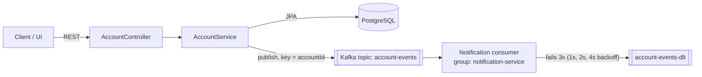

# Account Events Service


An **event-driven banking microservice**. It manages customer accounts through a REST API and publishes every change (account opened, deposit, withdrawal) to **Apache Kafka** so other systems can react in real time.

## 💡 Business problem

In a bank, many systems need to know when an account changes: fraud screening, customer notifications, statements and reporting. If the account service called each of them directly, it would be slow and fragile, and one system being down would break the others.

**Solution:** the account service publishes an event to Kafka, and every interested system consumes it independently. Failed messages are retried, and messages that keep failing go to a **dead-letter topic** so nothing is lost and the stream is never blocked.

## 🏗️ Architecture



## ✨ Key features

- **REST API** with validation and RFC 7807 problem-detail error responses
- **Ordered events per account:** the account id is the Kafka message key, so all events for one account land on the same partition
- **Reliable producer:** `acks=all` and idempotence enabled
- **Retry with exponential backoff, then a dead-letter topic** via Spring Kafka's `DefaultErrorHandler` and `DeadLetterPublishingRecoverer`
- **Idempotent consumer:** each event has an `eventId`, and duplicates are skipped
- **Optimistic locking** (`@Version`) so concurrent transactions can't corrupt a balance
- **Poison-pill safe:** `ErrorHandlingDeserializer` keeps a bad message from crashing the consumer
- Unit tests with **JUnit 5 + Mockito**, and CI with **GitHub Actions**

## 🧰 Tech stack

Java 21 · Spring Boot 3.3 · Spring Web · Spring Data JPA · Spring Kafka · PostgreSQL 16 · Apache Kafka 3.8 (KRaft) · Docker Compose · JUnit 5 · Mockito · GitHub Actions

## ▶️ How to run

**Prerequisites:** Docker Desktop.

```bash
git clone https://github.com/vasurayudu-java/account-events-service.git
cd account-events-service
cp .env.example .env          # set DB_PASSWORD
docker compose up --build
```

**Try it:**

```bash
# open an account
curl -X POST localhost:8080/api/v1/accounts \
  -H "Content-Type: application/json" \
  -d '{"customerName":"Jane Doe","type":"CHECKING"}'

# deposit / withdraw (use the id from the response)
curl -X POST localhost:8080/api/v1/accounts/{id}/deposits    -H "Content-Type: application/json" -d '{"amount":15000}'
curl -X POST localhost:8080/api/v1/accounts/{id}/withdrawals -H "Content-Type: application/json" -d '{"amount":12000}'
```

Watch the logs and you'll see the consumer raise `ALERT: large withdrawal`.

**Run the tests:** `mvn test`

## 📡 API

| Method | Endpoint | Description |
|---|---|---|
| POST | `/api/v1/accounts` | Open an account |
| GET | `/api/v1/accounts/{id}` | Get account details |
| POST | `/api/v1/accounts/{id}/deposits` | Deposit money |
| POST | `/api/v1/accounts/{id}/withdrawals` | Withdraw money (422 if funds are insufficient) |
| GET | `/actuator/health` | Health check |

## 🔭 Next improvements

- **Transactional outbox pattern**, so the database write and the Kafka publish can never get out of sync
- Persist processed event ids in a table instead of memory
- Avro or Protobuf schemas with a schema registry
- Testcontainers integration tests

---
*Personal project by [Vasu Rayudu](https://vasurayudu-java.github.io), showing event-driven microservice patterns I use professionally.*
